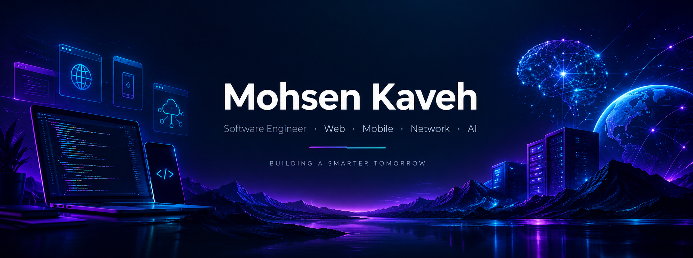

 <!-- Replace m-kaveh77 and all example links before publishing -->

 <div align="center">
  
</div>

<div align="center">

# Hey, I'm Mohsen 👋

### Software Engineer · Full-Stack Developer · AI & Network Enthusiast

*Building intelligent systems, beautiful interfaces, and technology that solves real problems.*

<a href="https://github.com/m-kaveh77">
  
</a>
<!-- <a href="YOUR_LINKEDIN_URL">
  
</a>
<a href="mailto:YOUR_EMAIL">
  
</a> -->


</div>

## `$ whoami`

```yaml
role: Software Engineer
focus:
  - Web Development
  - Mobile Applications
  - Networking & Infrastructure
  - Artificial Intelligence
mindset: Build things that matter.
currently_building: Adminova
mission: Turn complex ideas into elegant, reliable solutions.
```

I'm a technology enthusiast and software engineer passionate about building across multiple layers of the technology stack — from intuitive user interfaces to backend systems, network infrastructure, and AI-powered applications.

I enjoy exploring how different technologies connect, designing scalable architectures, solving challenging problems, and turning ideas into practical products.

- 🧩 **Web:** Modern, responsive applications and full-stack systems
- 📱 **Mobile:** Cross-platform experiences and mobile application development
- 🌐 **Networking:** Infrastructure, protocols, system connectivity, and troubleshooting
- 🤖 **AI:** Intelligent applications, automation, and machine learning exploration
- ⚙️ **Engineering:** Clean code, maintainable architecture, performance, and reliability

> I don't just want to make software work. I want to understand why it works, make it better, and build something worth sharing.

## 🛠️ Technology Universe

### Web & Software Engineering

<p>
  
</p>

### Mobile Development

<p>
  
</p>

### AI, Data & Automation

<p>
  
</p>

### Infrastructure, Networking & DevOps

<p>
  
</p>

### Databases & Development Tools

<p>
  
</p>

*This is a starter stack: keep only the technologies you actually use and can confidently discuss. Add tools that reflect your real expertise.*

## 🚀 Featured Projects

### 💎 Adminova — Modern React Admin Dashboard

A dashboard project focused on reusable components, structured UI architecture, data visualization, and efficient product management.

- Modular React component architecture
- Reusable tables, pagination, and product views
- Interactive dashboard components and data visualization
- UI consistency and maintainability

**Tech:** React · JavaScript · Tailwind CSS · Recharts

[Explore Repository](https://github.com/m-kaveh77/Adminova)

### 🤖 AI-Powered Applications

Intelligent software experiments exploring automation, data processing, and practical applications of artificial intelligence.

[Explore My Repositories](https://github.com/m-kaveh77?tab=repositories)

### 🌐 Networking & Infrastructure

Technical projects and experiments involving Linux, networking, system administration, connectivity, and infrastructure automation.

[Explore My Repositories](https://github.com/m-kaveh77?tab=repositories)

> Replace the example project sections with your strongest public repositories. A working demo, screenshots, a clear README, and meaningful commits are more valuable than an impressive project description alone.

## 📊 GitHub Insights

<div align="center">


</div>

## 🧠 How I Think

```text
Understand the problem.
        ↓
Design a clear solution.
        ↓
Build with purpose.
        ↓
Test, learn, and improve.
        ↓
Share knowledge with the community.
```

I believe great engineering combines technical depth, curiosity, thoughtful design, and a willingness to keep learning.

I'm especially interested in projects where software engineering, infrastructure, mobile experiences, and AI come together to solve meaningful problems.

## 🌱 What I'm Exploring

- Building better developer tools and reusable software components
- Designing scalable applications and reliable infrastructure
- Connecting AI capabilities to useful real-world products
- Improving application performance, security, and maintainability
- Learning from open-source projects and contributing where I can

## 🤝 Let's Connect

Have an interesting idea, an open-source project, or a challenging technical problem?

I'm always happy to connect with developers, exchange ideas, collaborate on meaningful projects, and learn from the community.

<div align="center">

<a href="https://github.com/m-kaveh77">
  
</a>
<!-- <a href="YOUR_LINKEDIN_URL">
  
</a> -->

### *Code is a tool. Creativity is the advantage. 🚀*


</div>
